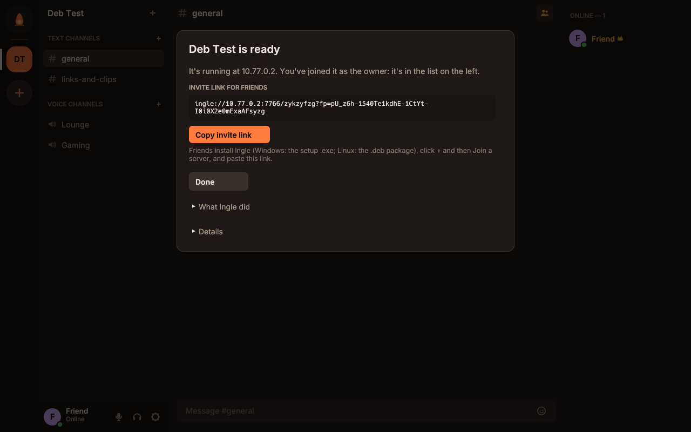

# Ingle

**Voice, webcams and screen sharing for your group, with Discord-style text channels.
Native Rust, end-to-end encrypted calls, free 1080p60 screen sharing (with sound on
Windows), and a server you can run yourself.**

*Ingle* is an old Scots word for the fire in a hearth: the place people gather. It's a
working name; see [Naming](#naming) for the shortlist and how to rename.


| | Ingle | Discord (free) |
|---|---|---|
| Screen share | up to 1080p60 or 1440p30, free | 720p30 (1080p60/4K needs Nitro) |
| Stream sound | stereo Opus 128 kbps, only to viewers (Windows for now) | yes |
| Voice | Opus 64 kbps default, up to 192 kbps for everyone | 64 kbps default, 96 max without boosts |
| Calls end-to-end encrypted | yes, always, with a call code you can compare | yes (DAVE) |
| Account | none: a key on your PC is your identity | email account; age checks rolling out |
| Hosting | your own server (one small program) | Discord's servers only |
| App | native, ~28 MB .exe, no Electron | Electron |

## What's in the box

- **`ingle.exe`**: the desktop app.
- **`ingle-server.exe`**: the community server. One person runs it; everyone else
  connects with an invite link. It keeps text history (SQLite) and relays voice and video
  without being able to decrypt them.
- **`vps\ingle-server-linux-x86_64`** and **`-aarch64`**: the same server for Linux, as
  static programs that run on any distribution. The app uploads one of them when it sets
  up a server for you (see [Your server](#your-server)).
- **`ingle-bot.exe`**: a test participant that talks with a tone, shares a test-pattern
  camera and screen (with a test chord as stream sound), so you can try everything alone.

Features:

- Servers with **text channels** (Discord-like: markdown, replies, @mentions, reactions,
  edits, deletes, typing indicators, spellcheck in four languages, history) and **voice
  channels**, each with its own text chat.
- **Unread messages are marked everywhere**: channels (a dot and a bold name, red badges
  for mentions), voice channels' chats (also on the call's chat button), servers (the pill
  beside their icon), direct messages (who sent them, under the home button), a "NEW" line
  above the first one in the conversation, the window's title, and on Windows the icon by
  the clock (with where they are in its tooltip) and the taskbar button. What came while
  Ingle was closed shows as unread when it's back.
- **Voice**: Opus with in-band FEC, adaptive jitter buffer with loss concealment, echo
  cancellation and auto gain (WebRTC AEC3/AGC2 via `sonora`), noise suppression (RNNoise
  or WebRTC NS) or **voice isolation** (DeepFilterNet3: only your voice, no keyboard, mouse
  or machines), voice activity or **push-to-talk** (global key, also
  mouse buttons 4/5), per-person volume, mute/deafen, mic test.
- **Webcams**: H.264, shown automatically to everyone in the channel.
- **Screen sharing ("Go Live")**: whole screen or one window, H.264 tuned for screen
  content, presets from 720p30 to 1080p60 and 1440p30. Viewers opt in by clicking
  *Watch Stream*, so a stream only costs bandwidth for people watching. Several people can
  stream at once and you can watch several streams.
- **Stream sound** (Windows): a whole-screen share sends everything your PC plays
  *except the call itself*, so viewers never hear themselves echoed. A window share sends
  just that app's sound. Viewers get their own stream-volume slider.
- **End-to-end encryption** of all voice, video, screen and stream sound. Keys rotate
  whenever someone joins or leaves; the server only relays ciphertext. Everyone sees a
  *call code*: if the codes match, nobody (not even the server) can listen in.
- **No accounts**: your identity is a key pair stored on your PC; the same identity works
  on every server. Owners and admins can create invite links (with limited uses or an
  expiry from the server's command line), kick, ban, promote, and create, rename or delete
  channels.

## Install

**Windows 10/11 (64-bit):** run `Ingle-Setup-0.1.0.exe`. It installs for your account
only (no admin rights), adds Ingle and Ingle Server to the Start menu and a desktop
shortcut, makes `ingle://` invite links open Ingle, and shows up in Settings → Apps for
uninstalling. The installer isn't code-signed yet, so Windows SmartScreen may say "Windows
protected your PC": click **More info → Run anyway**. Uninstalling keeps your identity
and settings in `%APPDATA%\Ingle`. To update, run the new setup: it quits a running Ingle
by itself (even one in the tray) before replacing it.

While Ingle runs on Windows, its campfire icon sits by the clock (Windows may tuck it under
the **^** arrow; drag it next to the clock to keep it in view). Click it to open Ingle;
right-click it to mute, deafen, leave voice or **Quit Ingle**. Like Discord, the window's
close button keeps Ingle running there, so you stay in voice and friends can still reach
you. The first time, Ingle asks whether you want that; change it later in
**Settings → Windows**.

**Linux (Ubuntu, Linux Mint, Pop!_OS, Debian and relatives, 64-bit):** open
`ingle_0.1.0_amd64.deb` with your software installer, or run
`sudo apt install ./ingle_0.1.0_amd64.deb`. Ingle appears in the app menu, `ingle://`
links open it, and you get the `ingle-server` and `ingle-bot` commands. It works on
Ubuntu 22.04 or newer, Linux Mint 21+, Pop!_OS 22.04+ and Debian 12+. On Wayland
desktops, screen sharing and push-to-talk outside the window don't work yet; pick the
Xorg session at the login screen (for example "Ubuntu on Xorg") to use them.

Hosting on a Linux desktop or home server as a background service (for a VPS, the app's
[Create a server](#your-server) does all of this for you):

```
sudo nano /etc/default/ingle-server          # INGLE_SERVER_ARGS="--public-host your.domain"
sudo systemctl enable --now ingle-server
sudo journalctl -u ingle-server               # your owner link and invite link
sudo -u ingle-server ingle-server --data /var/lib/ingle-server invite   # more invites
```

The server's data lives in `/var/lib/ingle-server` and survives removing the package
(`apt purge ingle` deletes it).

Only one copy of the app runs per profile: opening it again, or clicking an invite link
while it's open, brings the open window forward, even from the tray (and joins the server
in the link).

## Quick start

1. **Install Ingle** (above). Your friends install it too: Windows people run the setup
   `.exe`, Linux people install the `.deb`.
2. **Make a server.** Open Ingle and click **Create a server**. Pick one:
   - **Rent a server** (recommended): Ingle creates a small server for you at
     DigitalOcean, about $6 a month ($4 for the smallest), and sets it up. You need a
     DigitalOcean account and an API token; the app walks you through both.
   - **Use a server I already have**: any Linux VPS from any provider. Type its address
     and password (or key file) and Ingle sets it up over SSH, or shows you the two
     commands to do it yourself.

   When it's done you're in your new server as its owner, and the app shows an
   **invite link**.
3. **Invite friends.** Click **Copy invite link** and send it. Friends click the **+** on
   the left, then **Join with an invite link**, and paste it. (Clicking an `ingle://` link
   also works.) More links later: the **+** next to the server name.
4. Click a voice channel (Lounge, Gaming) to join; use the buttons at the bottom of the call
   for mic, camera, screen share, deafen and leave. Click a person's stream to watch it.

## Your server

The server keeps your channels and message history and relays calls (it can't listen in:
calls are end-to-end encrypted). It needs to be on all the time and reachable from the
internet on **UDP port 7766**, which is why a small rented server (a "VPS") is the easy
choice: about $4–6 a month, and it doesn't depend on anyone's PC being on.


### Renting one (DigitalOcean)

DigitalOcean was picked for being cheap, very reliable and simple to sign up for. Prices
when this was written (October 2026): $4/month (512 MB memory, 500 GB of traffic) or
$6/month (1 GB, 1 TB, recommended), billed only for the time the server exists. The app
shows the current prices from your account before you buy anything.

1. Make an account at [digitalocean.com](https://cloud.digitalocean.com/registrations/new)
   (card or PayPal).
2. In the control panel open **API** (under your account), click **Generate New Token**,
   name it `Ingle`, choose **Full Access** (or **Custom Scopes** with *droplet* and
   *ssh_key*), click **Generate Token** and copy it.
3. In Ingle: **Create a server → Rent a server**, paste the token, pick a size and the
   place nearest you, and click **Create my server**.

Ingle then adds its SSH key to your account (as "Ingle"), creates an Ubuntu 24.04 server
named `ingle-<your server name>`, waits for it to start, installs Ingle Server on it and
checks that it can be reached. That takes a couple of minutes. **The token isn't saved**;
you can delete it on the API page afterwards. To stop paying, delete the server ("droplet")
in DigitalOcean's control panel under **Droplets**. If the setup fails after the server
was created, the app offers to try again or to delete it.

Ingle's SSH key is `ssh/ingle_ed25519` in your Ingle settings folder
(`%APPDATA%\Ingle\config` on Windows, `~/.config/ingle` on Linux), so you can log in
yourself: `ssh -i <that file> root@<server address>`. The app also notes the servers it set
up in `hosted-servers.json` there.



### Using a server you already have

Any 64-bit (x86-64 or ARM64) Linux server with systemd works: Ubuntu 22.04 or newer,
Debian 11+, Fedora, Rocky, Alma and so on, from any provider (Hetzner, Vultr, Linode,
OVH, AWS, Oracle Cloud's free tier...). In Ingle choose **Create a server → Use a server
I already have**, then type:

- **Server address**: its IP address or domain name.
- **User**: usually `root`. Another user works if it can use `sudo` (type its password in
  the sudo box if sudo asks for one).
- **Password** or **Key file**: OpenSSH, PEM or PKCS#8 private keys, with or without a
  passphrase. PuTTY `.ppk` keys need exporting first (PuTTYgen: *Conversions → Export
  OpenSSH key*).

Ingle logs in once and doesn't save the password.

**Firewalls.** Ingle opens UDP 7766 in the server's own firewall (ufw, firewalld or plain
iptables, including Oracle Cloud's), but some providers also put a firewall in front of
the server that only their website can change. If the app says it can't reach the server,
add an inbound rule there for **UDP port 7766 from anywhere (0.0.0.0/0)**, then click
**Check again**:

| Provider | Where |
|---|---|
| Amazon Lightsail | the instance's **Networking** tab → IPv4 firewall → add rule: Custom, UDP, 7766 |
| Amazon EC2 | the instance's **security group** → inbound rules → Custom UDP, port 7766, source 0.0.0.0/0 |
| Google Cloud | **VPC network → Firewall** → create an ingress rule for UDP 7766 from 0.0.0.0/0 |
| Microsoft Azure | the VM's **Networking** page → add an inbound port rule for UDP 7766 |
| Oracle Cloud | the subnet's **security list** → add an ingress rule: UDP, destination port 7766, source 0.0.0.0/0 |
| DigitalOcean, Hetzner, Vultr, Linode | no firewall unless you added one; if you did, allow inbound UDP 7766 |

SSH (TCP port 22) must be allowed too for the setup itself.

### Setting it up by hand

**Create a server → Use a server I already have → Set it up by hand instead** saves the
server program and the setup script (`install-ingle-server.sh`) into a folder and shows
the commands with your server's address filled in. In short:

```
scp ingle-server-linux-x86_64 install-ingle-server.sh root@SERVER:/tmp/
ssh -t root@SERVER sh /tmp/install-ingle-server.sh --binary /tmp/ingle-server-linux-x86_64 --public-host SERVER
```

(Use `ingle-server-linux-aarch64` on ARM servers.) The script prints your **owner link**
(use it first, in **Join a server**: it works once and makes you the owner) and an invite
link for friends. Options: `--public-host` (address for the links; detected if left out),
`--name` (name of a new server), `--port` (default 7766).

### What the setup does on the server

- installs the program as `/usr/local/bin/ingle-server`,
- creates an `ingle-server` system user and keeps the data in `/var/lib/ingle-server`,
- adds a systemd service, `ingle-server`, that starts by itself and restarts if it stops,
- opens UDP 7766 in ufw/firewalld/iptables if one of them is active.

Running the setup again (from the app or by hand) updates the program and keeps your
server, its messages and its links. Useful commands on the server:

```
systemctl status ingle-server                       # is it running?
journalctl -u ingle-server -n 50                     # its log
sudo -u ingle-server ingle-server --data /var/lib/ingle-server invite --uses 5 --hours 24
sudo -u ingle-server ingle-server --data /var/lib/ingle-server owner-invite   # a new owner link
```

### Hosting on your own PC instead

Free, but your PC has to stay on for friends to use the server, and friends outside your
home need your router to forward a port. On Windows, open **Ingle Server** from the Start
menu (or double-click `ingle-server.exe`); on Linux run `ingle-server`. Allow it through
the firewall when asked. It prints two links:

- **YOUR OWNER LINK**: use it yourself, once, in **Join a server**, to become the owner.
- **Invite link for friends**: give this to people you want to invite.

The server keeps everything in a data folder: `%APPDATA%\Ingle\server` when started from
the Start menu, otherwise `ingle-data` next to where it runs (or `--data <folder>`). Keep
that folder: it holds the chat history and the server's TLS key, and invite links pin
that key's fingerprint. Need another link later? Run `ingle-server.exe invite` (options:
`--uses 5`, `--hours 24`), or create one in the app from the server menu. Lost the owner
link? `ingle-server.exe owner-invite`.

#### Friends outside your home network

The links printed at first use your local network address. For friends elsewhere:

1. On your router, **forward UDP port 7766** to the PC running the server (it's UDP, not
   TCP: everything runs over QUIC).
2. Start the server once with your public address or a DNS name, for example
   `--public-host 203.0.113.7` or `--public-host play.example.com`. The server remembers
   it, so later starts (the Start menu shortcut, the Linux service) keep using it. On
   Windows, in a Command Prompt:

   ```
   "%LOCALAPPDATA%\Programs\Ingle\ingle-server.exe" --data "%APPDATA%\Ingle\server" --public-host 203.0.113.7
   ```

   It now prints links with that address. `--public-host ""` goes back to the local one.

Other options: `--bind 0.0.0.0:7766` (address and port to listen on), `--data <folder>`,
`--name "Our Camp"` (name for a new server).

### Trying it alone

Start a server and join it with your owner link, then add a pretend participant (on
Windows, tick *Test bot* in the installer; it lands next to `ingle.exe`):

```
ingle-bot --join "<invite link>" --name Mara --voice Lounge --camera --screen
```

On Windows that's `"%LOCALAPPDATA%\Programs\Ingle\ingle-bot.exe" --join ...` from a
Command Prompt.

Mara joins Lounge, "talks" with a tone, turns on a test-pattern camera and goes live with
a test pattern and a quiet chord. Add `--no-sound` for a silent stream, `--say "hi"` to
post a message, `--watch` to have the bot watch other people's streams. You can also run a
second copy of the app as a different person: `ingle.exe --profile alt`.

### Settings worth knowing

Open them with the gear next to your name (**Voice & Video** tab):

- **Input mode**: voice activity (automatic, uses RNNoise's speech detector) or
  push-to-talk. The default PTT key is the backtick/tilde key; mouse buttons 4/5 work too.
- **Noise suppression**: *Strong (AI)* (RNNoise, default), *Standard* (WebRTC), off, or
  *Voice isolation*: DeepFilterNet3 cleans the sound (typing, clicks, fans and machines
  included) and only the close voice at your mic gets through (no TV, no people across the
  room, nothing between your words). About 1.5 ms of CPU per 10 ms of audio; 30 ms more delay.
- **Voice quality**: 24–192 kbps; camera device and quality; screen-share quality.
- Right-click a person for their volume; right-click a stream for stream volume.
- **Windows** tab (on Windows): whether the close button keeps Ingle running in the tray
  (on by default) or quits it.

### Your data

- Your identity is `identity.key` in `%APPDATA%\Ingle\config`. It is your account: back it
  up, and don't share it. Copying it to another PC moves your identity.
- The app remembers servers, settings and volumes in `config.json` next to it.

## Troubleshooting

- **Closed Ingle and can't find it / it's still running**: closing the window keeps Ingle
  running by the clock (look under the **^** arrow). Click the campfire icon to open it, or
  right-click it and choose **Quit Ingle**. To make the close button quit instead, untick
  it in **Settings → Windows**.
- **"mfplat.dll was not found"**: Windows "N" editions ship without Media Foundation.
  Install the *Media Feature Pack* from Windows Settings → Apps → Optional features.
- **Blank or broken window**: the app draws with DirectX 12/Vulkan (wgpu) and falls back to
  OpenGL by itself. To force OpenGL: `ingle.exe --renderer glow`.
- **Stream has no sound / "Sharing without sound"**: capturing app audio needs Windows 10
  build 20348 or newer (Windows 11 is fine). Otherwise the stream works without sound.
- **Friends can't connect**: for a VPS, see [Firewalls](#using-a-server-you-already-have)
  (UDP 7766 must be allowed in the provider's firewall) and check
  `systemctl status ingle-server` on the server. For a server on your PC: check the
  server window says it's listening, the router forwards **UDP** 7766, Windows Firewall
  allows `ingle-server.exe`, and the link has your public address (`--public-host`).
- **Setting up a server fails**: the setup dialog's **Details** show what the server
  said. Running the setup again is always safe. "doesn't accept the password": many
  providers turn off password logins for root; use your key file, or the user and password
  from the provider's welcome email.
- **Can't hear anyone (or nobody hears you) until you restart**: since 0.6.4, a microphone
  or speakers that stop working mid-call (a virtual device like NVIDIA Broadcast or a GoXLR
  restarting, a USB hiccup) are reopened by themselves within a second or two; if it takes
  longer, the call screen says so. If it still happens, the log says whether a device
  stopped or someone's sound didn't decrypt: send a bug report with the log.
- **The taskbar or Start menu shows an old icon**: Windows keeps the icons it has shown by
  file name. Since 0.6.5 the installer points Ingle's shortcuts and taskbar pins at a copy
  of the icon named after the icon itself, so a new icon shows as soon as it's installed.
  If a pin still shows the old one, unpin Ingle and pin it again.
- **Logs**: the app writes `ingle.log` next to your config in `%APPDATA%\Ingle\config`
  (started fresh each launch, with the run before kept as `ingle.previous.log`; set
  `RUST_LOG=debug` for more detail). If the app crashes it says so in a message box and
  records the reason there. If its window ever stops responding, the log records what the
  window was doing, which of Ingle's threads were busy and how loaded the PC was. Bug reports
  include both logs. The server logs to its console.

## Building from source

Requirements: Rust 1.91 or newer (`rustup`). On Windows, also the Visual Studio Build
Tools with "Desktop development with C++", and CMake on the `PATH` for libopus
(`winget install Kitware.CMake`).
[NASM](https://www.nasm.us/) on the `PATH` is optional and makes H.264 encoding about 3×
faster. On Linux: `cmake`, `clang` (bindgen needs libclang), `libasound2-dev` and
`libx11-dev`.

```
cargo build --release                  # target/release/ingle(.exe), ingle-server(.exe)
cargo build --release -p ingle-engine --example bot
scripts/build-vps-server.sh            # dist/vps/ingle-server-linux-{x86_64,aarch64} (static)
cargo test --workspace                 # unit tests + end-to-end tests over real QUIC
installer/linux/build-deb.sh           # dist/ingle_<version>_amd64.deb (needs dpkg-dev)
installer/windows/build.sh             # dist/Ingle-Setup-<version>.exe (needs NSIS)
```

The icons and installer artwork are drawn by `tools/make-icons.py` (needs Pillow). Build the
Linux binaries on the oldest distribution you want to support (the released .deb was
built on Ubuntu 22.04): a binary only runs where its build machine's glibc, or a newer one,
is installed. `build-deb.sh` takes `REL=<folder with the release binaries>`.

The Windows `.exe` files in this release were cross-compiled from Linux with MinGW
(`scripts/build-windows.sh`) and only depend on DLLs that ship with Windows. Building
natively with MSVC should work but hasn't been tried yet.

Layout:

```
crates/proto    wire protocol, identities, E2EE primitives, invite links, QUIC helpers
crates/server   ingle-server: SQLite storage, auth, chat, SFU media relay
crates/engine   client engine: networking, E2EE, audio + video pipelines (no UI)
crates/host     server setup: renting from DigitalOcean, installing over SSH, reachability
crates/app      ingle: the egui desktop app
```

See [ARCHITECTURE.md](ARCHITECTURE.md) for how it works and [RESEARCH.md](RESEARCH.md)
for the research behind it.

## Status: what's tested and what isn't

Tested in a Linux sandbox: 52 automated tests including end-to-end runs with a real server
and several clients over QUIC (chat, invites, E2EE voice in both directions, webcam
pixels, 1080p screen share, stream sound reaching only viewers in stereo, late joiners,
kicks). The app was driven through its real UI on a virtual X display. All three Windows
`.exe` files were run under Wine on Linux: the server, the bot and the app (logging in,
chat, joining voice with the E2EE call code, watching a 1080p screen share and a webcam,
going live with the test pattern while a Linux client watched it, and falling back from
DirectX/Vulkan to OpenGL when no GPU driver was there). The Windows setup was run under
Wine too: the wizard, a fresh install, an upgrade, the Start menu shortcuts, the server
shortcut, handing an invite link to the open app, and uninstalling. The .deb was
installed and run on Ubuntu 22.04 and 24.04 (app, a call with a webcam and a stream, the
server as the service account, removing and purging).

**Server setup** (Create a server) was tested end to end against a real Ubuntu 24.04
system with systemd, OpenSSH and ufw switched on (blocking everything but SSH) standing
in for a VPS: as root with a password; as a sudo user with and without a sudo password;
with ed25519, passphrase-protected RSA and ECDSA PEM keys; running the setup again on a
set-up server; the by-hand commands; a firewall in front of the server (the app says so,
then recovers after **Check again**); and a friend joining with the invite link, chatting
and calling with camera and screen share through it. Renting was tested against a
stand-in for DigitalOcean's API that follows its documented requests and answers and
boots that same Ubuntu system as the "droplet", including a wrong token, a token without
the needed scopes, the droplet limit, an SSH key already on the account, retrying and
deleting. The Windows build ran both flows under Wine, through the app's own window. The
ARM64 server program was run under emulation. The tray icon was tested on the Windows build
under Wine with a system tray: the icon, click to open, the first-close note, hiding and
coming back, Mute/Deafen/Leave voice/Quit from its menu, a second launch bringing back the
hidden window, `--quit`, and the setup quitting a hidden Ingle that was in a call before
replacing it. **Not tested: the real DigitalOcean API
and payment** (this sandbox can't reach DigitalOcean), and real cloud firewalls.

**Not yet tested on a real Windows PC**: microphone/speaker devices (WASAPI), webcams
(Media Foundation), screen capture (Windows Graphics Capture), stream sound (process
loopback), global push-to-talk and GPU rendering. These use well-known libraries, but
expect a rough edge or two on first run, and please report what you see.

Known gaps: no file/image uploads, no direct messages or friends list, no custom emoji,
screen sharing on macOS and Wayland isn't implemented (X11 works), stream sound is
Windows-only, software H.264 only (no GPU encoding yet), no simulcast, no mobile or web
client. The roadmap is in [ARCHITECTURE.md](ARCHITECTURE.md#roadmap).

## Naming

"Ingle" came out on top of a name search on 2026-10-11 (details and sources in
[RESEARCH.md](RESEARCH.md#7-naming)):

1. **Ingle**: Scots for hearth fire. ingle.chat and inglechat.com looked free; ingle.com is
   taken and ingle.app is listed for sale; all US INGLE trademarks are dead.
2. **Firefolk**: "the people around the fire". .chat/.dev free; .com/.app taken; no US
   marks found.
3. **Hobfire**: a coinage (the hob beside the hearth). The only name with the .com and .app
   both looking free.

These are availability checks, not legal clearance. To rename, change `APP_NAME` and
`APP_ID` in `crates/proto/src/lib.rs` and the binary names in the crates' `Cargo.toml`.

## License

`Cargo.toml` marks the code as MIT OR Apache-2.0, the usual Rust choice; change it before
publishing if you'd rather use something else. Third-party parts: Inter font (SIL OFL 1.1,
`crates/app/assets/fonts/OFL.txt`), libopus (BSD), OpenH264 (BSD, compiled from source;
see the H.264 note in the [roadmap](ARCHITECTURE.md#roadmap)), SQLite (public domain),
RNNoise (BSD), DeepFilterNet3 and its model (MIT OR Apache-2.0, run with tract, MIT OR
Apache-2.0), spellbook (MPL-2.0) and the spellcheck dictionaries (SCOWL, MIT AND BSD; RLA-ES,
used under MPL-1.1; Grammalecte, MPL-2.0; see `crates/app/assets/dict/README.md`).
