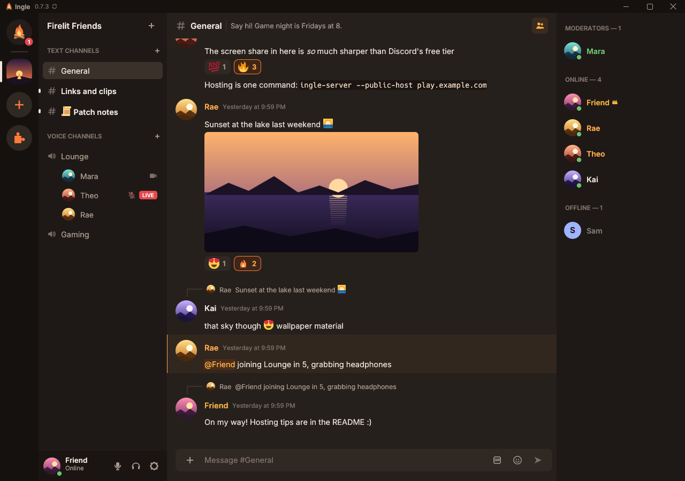
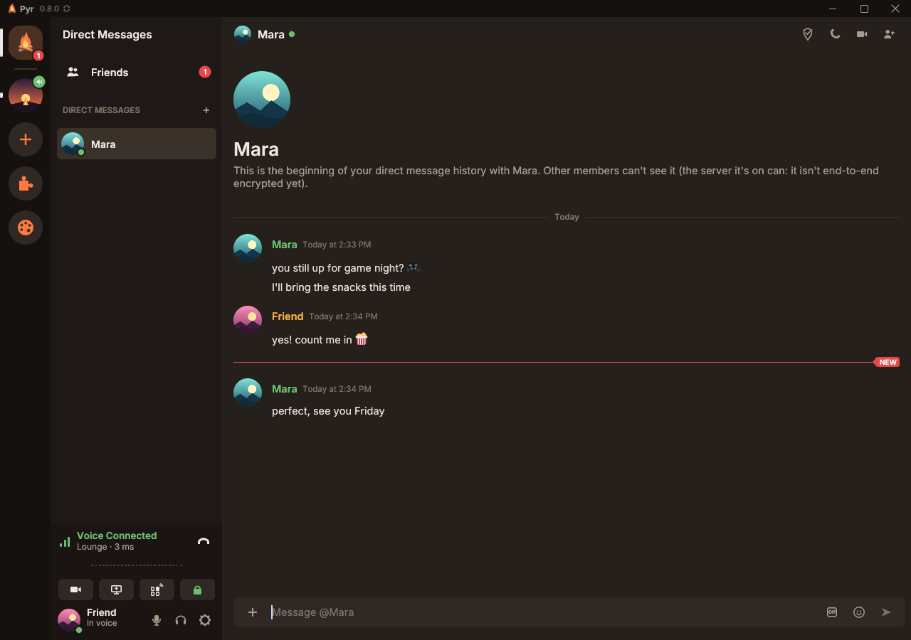
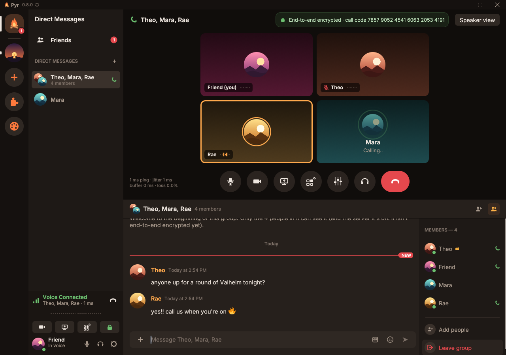
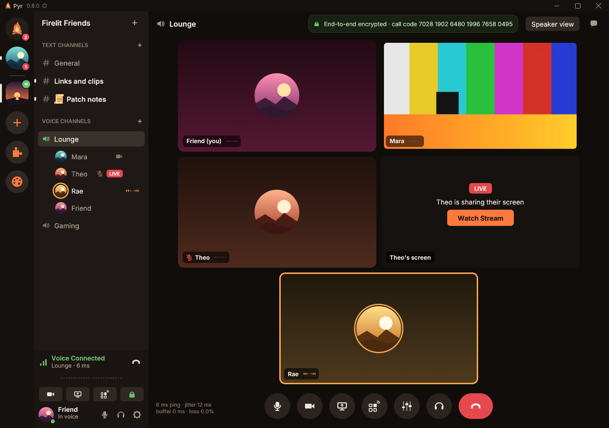
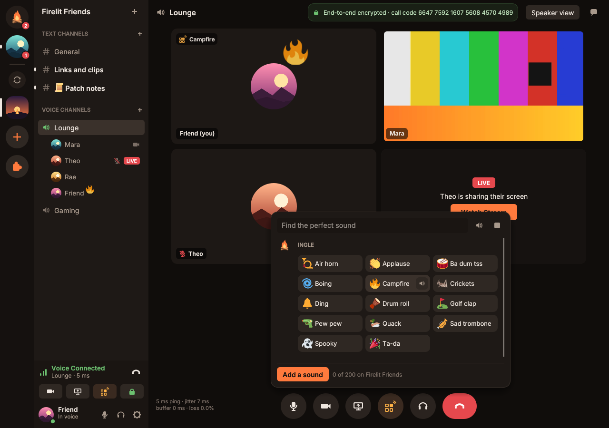
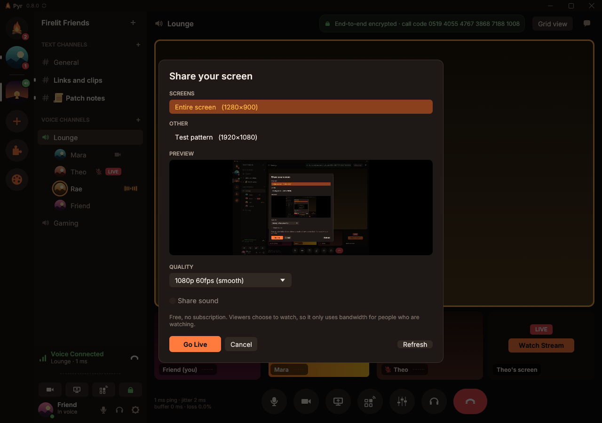
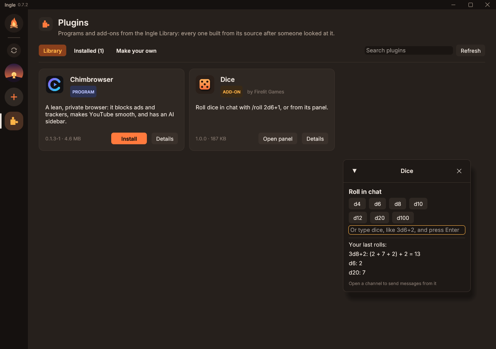
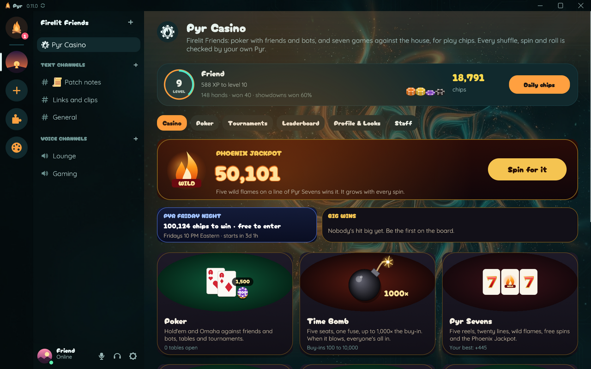
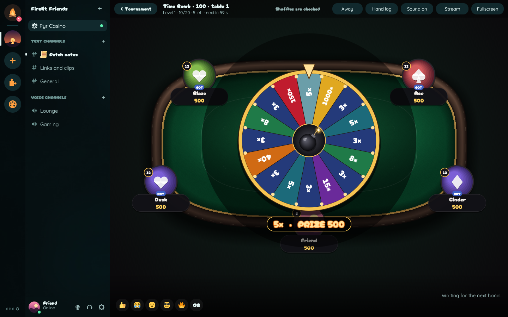
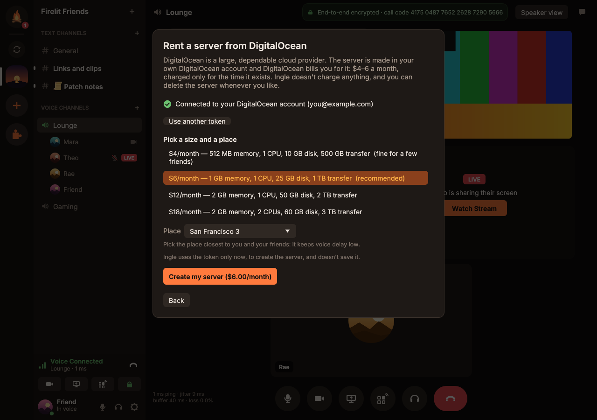

# Pyr

**Voice channels, webcams, smooth 1080p60 screen sharing, a soundboard and Discord-style
text chat for your group. A native Rust app with end-to-end encrypted calls, no accounts, and a server
you own, on any VPS from any provider: Pyr sets it up for you in a few minutes.**

*Pyr* is the ancient Greek word for fire (πῦρ, as in *pyre*): the campfire your group
gathers around.

**Download: [pyr.gg](https://pyr.gg)** (Windows 10 and 11;
a `.deb` for Ubuntu, Linux Mint, Pop!_OS and Debian). Made by
[Firelit Games](https://firelitgames.com/).



| | Pyr | Discord (free) |
|---|---|---|
| Screen share | up to 1080p60 or 1440p30, free | 720p30 (1080p60/4K needs Nitro) |
| Stream sound | stereo Opus 128 kbps, only to viewers (Windows for now) | yes |
| Voice | Opus 64 kbps default, up to 192 kbps for everyone | 64 kbps default, 96 max without boosts |
| Calls end-to-end encrypted | yes, always, with a call code you can compare | yes (DAVE) |
| Account | none: a key on your PC is your identity | email account; age checks rolling out |
| Hosting | your own server, on any VPS from any provider (the app sets it up) | Discord's servers only |
| App | native Rust, no Electron | Electron |

## Features

**Text chat**

- Servers with **text channels** and **voice channels** (each voice channel has its own
  chat), channel names that keep their spaces and capitals, with emoji if you like
  (📜 Rules, 🎮 Game Night), channel topics, server icons and profile pictures.
- Markdown, replies, **@mentions** (people, roles, @everyone and @here, suggested as you
  type), reactions, edits, typing indicators and history. Deleting a message asks first,
  showing the message and what goes with it (hold Shift to delete straight away).
- **Pictures**: PNG, JPEG, GIF or WebP, up to 10 per message and 10 MB each. Add them with
  the **+** button, drag them in, or paste them with Ctrl+V. Animated GIFs play.
- **GIF search**: type `/giphy` or `/klipy`, or click the GIF button (powered by GIPHY and
  KLIPY, each in its own tab; each server's owner turns them on with a free key).
- **Favorites**, like Discord's, for GIFs from GIPHY and KLIPY and for pictures people post
  (memes): point at one, in chat or in the GIF picker, and click the star in its corner.
  They wait in the GIF picker's first tab, ready to send on any server (a favorite picture is
  kept on your PC, so it's there even if the original is deleted).
- **Select and copy any text** like on a web page: drag from anywhere over the messages,
  across as many as you like; double-click a word, triple-click a paragraph; Ctrl+C.
  Right-click a message for Copy, **Copy link**, Open link, Copy text, Reply, Edit and
  Delete.
- Color emoji (Twemoji) with a searchable picker, and each server's own **custom emoji**.
- Spellcheck in English (US and UK), Spanish and French: right-click a word for fixes.
- **Unread messages are marked everywhere**: channels (a dot and a bold name, red badges for
  mentions), voice channels' chats, servers, direct messages (who sent them, under the home
  button), a NEW line in the conversation, the window title, and on Windows the icon by the
  clock and the taskbar button. What came while Pyr was closed shows as unread.
- Notification sounds, and muting for a server, a channel or a conversation.

**Friends, direct messages and calls**

- Add friends, accept or decline requests, and block people.
- **Direct messages** with anyone you share a server with. Other members can't see them,
  and like everything written in Pyr they're end-to-end encrypted (0.9): the server keeps
  only ciphertext, so whoever runs it can't read them.
- **Call friends**, like Discord: the call and video buttons at the top of a direct message,
  or **Call** when you right-click someone's name. It rings them for 30 seconds, about as long
  as Discord does (with Accept and Decline, a Windows notice and a flashing taskbar button if
  Pyr is hidden), then counts as missed; the call shows above
  your chat, and it's end-to-end encrypted like voice channels. Only the two of you see it;
  server moderators can't mute you in it, and blocking someone ends it.
- **Group conversations and group calls** of up to 10 people: start one with the **+** by
  Direct Messages, or click **Add people** during a call (the call moves to the new group,
  and everyone added rings). Whoever hasn't picked up yet shows in the call as *Calling…*.
  Groups have their own chat and members list, can have a name, and can be left any time.





**Voice**

- Opus with error correction and loss concealment, echo cancellation and automatic gain
  (WebRTC AEC3/AGC2), noise suppression (RNNoise or WebRTC) or **voice isolation**
  (DeepFilterNet3: only your voice gets through, no keyboard, mouse, fans or machines).
- Voice activity or **push-to-talk** with a global key that still works in your game (mouse
  buttons 4/5 too), per-person volume, mute and deafen, and a mic test. Right-click your
  name for Mute and Deafen, as in Discord (deafening mutes you too).
- **Soundboard**, like Discord's but better: Pyr's own sounds, each server's (up to 200,
  10 seconds each, trimmed and evened out in loudness as they're added), favorites, recently
  played, a sound when you join voice, and keys that play sounds even in a game. Every
  sound you can reach plays in any call; hover to hear one yourself first, and mute anyone's
  sounds just for you.
- **Server Mute and Server Deafen** for moderators: a server muted person isn't heard (nor
  is their stream's sound), a server deafened one hears nobody and isn't heard either (like
  deafening yourself), until a moderator above them undoes it, in any voice channel of the
  server. A moderator can't undo their own (only the owner can).
- Calls stay connected while the server restarts or updates, and a microphone or speakers
  that drop out mid-call (a USB hiccup, a virtual device restarting) come back by themselves.
  A camera or screen share that was on stays off until you turn it back on (Pyr offers to):
  what's on your screen may have changed meanwhile.
- On Windows, Pyr marks its packets as voice for your network (Quality of Service), as
  Discord does.





**Video and screen sharing**

- **Webcams** (H.264), shown to everyone in the channel.
- **Go Live**: share a whole screen or one window, with a live preview before you start,
  from 720p30 to 1080p60, or 1440p30 for sharp text. Viewers opt in with **Watch Stream**
  (on the stream, or from the person's profile when you click their name in the channel
  list: **Join and Watch** from anywhere else), so a stream only uses bandwidth for the
  people watching it. Several people can stream at
  once, and a sound plays when someone starts watching.
- **Stream sound** (Windows): a whole-screen share sends everything your PC plays *except
  the call itself*, so viewers never hear themselves; a window share sends just that app's
  sound. If a program like Voicemeeter or SteelSeries Sonar plays your PC's sound again,
  Pyr finds the call in it and takes it back out.
- Grid or speaker view (the big tile follows whoever talks unless you pick one), full
  screen, a volume for each stream, and right-click to mute a person or a stream's sound.



**Privacy**

- **End-to-end encryption** of all voice, video, screen and stream sound. Keys rotate
  whenever someone joins or leaves; the server only relays what it can't read. Everyone
  sees a *call code*: if the codes match, nobody (not even the server) can listen in.
- Text messages and pictures are stored on your server (like Discord's), not end-to-end
  encrypted.
- **No accounts**: your identity is a key pair on your PC, and the same identity works on
  every server.
- **Make sure it's them**, without reading out codes: right-click someone (or click their
  name in chat, the shield at the top of your messages with them, or the button in a call
  with them) and **compare words** (both of you see the same six, each with its picture,
  when nobody's in between; say them to each other in a call, on the phone or in person) or
  **ask something only they'd know** (Pyr tells you both whether the answers match, and
  neither answer leaves your PC). If one of you says the words don't match, it doesn't count
  for either.
  A green shield then shows by their name everywhere. People you made sure of **vouch** for
  the people they made sure of (an outlined shield), so a whole group gets covered without
  everyone checking everyone. Someone else turning up under the name of a person you made
  sure of gets a red shield. When you've made sure of everyone in a call, the call says so,
  and the call code has nothing left to check.

**Your server**

- **Create a server** from the app on any Linux VPS from any provider: Pyr sets up one you
  already have over SSH, or creates a small one in your own DigitalOcean account (about
  $4–6 a month, billed to you by DigitalOcean). You're never tied to one host: a backup
  moves your server to another provider, history and all.
- **Roles and permissions**: your own roles with colors, listed separately in the member
  list if you like, with permissions for channels, messages, kicking, banning, muting and
  deafening in voice, roles, emoji and sounds, server settings and @everyone. Banning
  someone also turns off the invite link they joined with, so they can't walk back in
  through it as someone new (make a fresh link for everyone else).
- **Backups**: the owner's Pyr copies the whole server to their PC every hour (messages,
  pictures and the server's identity), and a new server can be set up from a backup.
- **Short invite links, like Discord's**: **Invite People** gives a link like
  `https://pyr.gg/qrslmnov` that lasts 7 days (or 30 minutes to forever, for as many people
  as you pick; **Edit invite link**). Pasted anywhere, it shows the server's name; opened, it
  goes to Pyr, which asks before joining, and someone who doesn't have Pyr yet gets it from
  the same page first. In Pyr's chat an invite shows as a card with **Join**. **Server
  Settings → Invites** lists the links that still work and takes them back; the owner can
  give the server its own (`https://pyr.gg/your-name`). A short link goes through pyr.gg's
  invite directory, which learns the server's name, address and member counts and its invite
  codes (never its messages or who's in it); the owner can turn short links off. The full
  link (`pyr://…`, or `https://pyr.gg/#n=…&join=…`) works without pyr.gg, as before.

**Plugins**

- The **Pyr Library** (the puzzle piece in the server list) has programs and add-ons, each
  built by Firelit Games from its source after someone read it. Pyr checks every file
  against the library's signed list before installing it, and again before opening a program.
- **Programs** open inside Pyr's window, on a page of their own (with a button in the
  server list while they run); **Pop out** puts one in a window of its own. The first is
  **Chimbrowser** (Windows): a lean, private browser that blocks ads and trackers, makes
  YouTube play smoothly, and has an AI sidebar for Claude, ChatGPT, Gemini and others.
- **Add-ons** run inside Pyr in a sandbox (WebAssembly with nothing to reach: not your files,
  not the internet, not the rest of your PC). They add /commands to chat (with hints as you
  type), show a small panel and keep a little data. **Dice** rolls dice: `/roll 2d6+1`, or
  click a die in its panel.
- **Skins** change how Pyr looks and sounds: its colors, a picture behind it, fonts and the
  sounds for messages, people joining and calls. They have a place of their own, **Skins** (the
  palette under Plugins): a Gallery of every skin in the Pyr Library with a big picture of
  Pyr wearing each, the ones that are yours to wear (and Campfire, Pyr's own), and making
  your own. Pyr made twenty to start: Aurora, Neon Drive, Abyss, Sakura Night, Elven Grove,
  Nebula, Terminal, Hallow's Eve, Obsidian & Gold and Stormcaller, next to Blood Moon, and ten
  inspired by the old Winamp skins, each with its own shapes and typeface: Alloy, Dot Matrix,
  Walnut, Candy Glass, Circuit, Carbon, Kaleidoscope, Field Kit, Starship and Cathedral.
  Since Pyr 0.8.1 a skin can change Pyr's shapes too: how round corners are, the shape of
  people's pictures, how what's selected is marked, and outlines on buttons and boxes. Skins
  have no code, and Pyr checks every file (fonts included) before it uses one.
- Every plugin and skin shows **who made it** (a skin someone sends in is listed under the
  name they gave it): click their name for everything they made. **Star** the ones you like,
  and sort by favorites, name, author or newest.
- **Make your own with Claude**: Plugins → Make your own starts an add-on in a folder with the
  plugin kit and a `CLAUDE.md` that explains Pyr add-ons to Claude. Say what it should do,
  try the `.wasm` it builds right there in Pyr, then **send it for review**: Pyr sends its
  Rust source (never a built file), and nothing is built or listed until it's been looked at.
  The kit, a template and Dice are in [`plugins/`](plugins).
- **The Claude connector** (`pyr-mcp`, installed with Pyr; Settings → Claude adds it to
  the Claude app, or gives the line for Claude Code) lets Claude make skins and plugins with
  you: it starts one, puts a skin on your Pyr as you talk it over, checks it the way the
  Library will, and sends it in for review, and new versions of yours later. What it sends is
  signed with your Pyr identity, so only you can send a new version of what you sent, and
  Make your own (on the Plugins or Skins page) shows whether yours were approved, with the
  reviewer's note. How to make a skin: [`skins/`](skins).



**Pyr Casino** (0.10)

- Every server has a casino for **play chips** (they can't be bought or cashed out): poker
  with the people there and with bots, and seven games against the house: **Pyr Sevens**
  (five reels, twenty lines, wild flames, free spins and the Phoenix Jackpot, which grows
  with every spin anyone makes there), **blackjack**, single-zero **roulette**, **baccarat**,
  **craps**, **dice** and **keno**.
- **Nobody can rig it, the house included.** Before each round the server commits to a secret
  seed (it shows only its SHA-256), your Pyr adds a seed of its own with the bet, and when
  the round is over the server shows its seed and your Pyr plays the whole round again to
  check every reel, card, ball and die. Poker shuffles are checked the same way. The count
  of rounds checked is on every table.
- **Time Bombs**: a five-player sit & go. A wheel picks the prize when the table fills (3
  to 1,000 times the buy-in) and the winner takes it all; after a three-minute fuse the bomb
  goes off and every hand is all in. Bots take any seat nobody sits in.
- **Pyr Friday Night**: a free tournament every Friday at 10 PM US Eastern, its prize money
  the week's rake (5% of a cash-table pot, 3 big blinds at most, nothing without a flop).
- Poker extras: a hand strength meter, right-click anyone for their hands and stats, a time
  bank with a countdown, tournaments with climbing blinds, and **Game Masters and
  Ambassadors** who give chips, looks and prize boxes (within an allowance set by the rake,
  logged for the owner).
- **Fullscreen** (F11) and **Streamer mode**: hole cards stay face down until you hold Space,
  and invite links are hidden; it turns on by itself while you share your screen. While you
  play, the game fills Pyr's window (a window capture shows nothing of your servers), a
  quarter of it down one side can stay clear for a camera and overlays, the balance is bigger
  with the session's winnings beside it, and results are called out big enough to read on a
  stream.





**The app**

- Updates itself: a glowing green **Update** button appears at the top of the window, by
  Pyr's name and version (on Linux, at the bottom of the server list), when a new version
  is out, and updating puts you back in the voice channel you were in. **Check for updates**
  (click the version, Settings → About, or the tray icon's menu, which also has **Update
  Pyr** once there's one) looks right away instead of waiting.
- On Windows it lives by the clock (closing the window keeps you in voice), and can start
  with Windows, straight into the tray.
- **Idle**, like Discord: five minutes away from the keyboard and mouse (and quiet in calls)
  and you show with a yellow moon instead of the green dot, back to green the moment you
  return. Click your name at the bottom left to say you're idle yourself.
- Error messages stay until you dismiss them and have a Copy button. **Report a bug**
  (Settings → About, or Report on an error) sends Firelit Games what happened, your Pyr
  version and system, and the log if you tick it. No account needed, and a report that
  can't be sent stays in the window to send again.

## Install

**Windows 10/11 (64-bit):** download **Pyr-Setup.exe** from
[pyr.gg](https://pyr.gg) and run it. It installs for your
account only (no admin rights), adds Pyr to the Start menu and the desktop, makes
`pyr://` invite links open Pyr, and shows up in Settings → Apps for uninstalling. It
can also add **Pyr Server** (to host on your own PC) and a **test bot** (to try calls on
your own). The installer isn't code-signed yet, so Windows SmartScreen may say "Windows
protected your PC": click **More info → Run anyway**. Uninstalling keeps your identity and
settings in `%APPDATA%\Pyr`.

After that, Pyr updates itself. It looks for a new version when it starts and every few
hours; when there is one, a green **Update to …** button appears at the top of the window,
next to Pyr's version (pointing at it says if you've missed several). Click it: Pyr
downloads the update, checks it against Firelit Games' signature, installs it and opens
again where you were. The signed release information has dates, and Pyr never takes one
past its date or older than one it has already seen, so a hacked website can't hide a newer
release by serving an old one.
Running a newer setup by hand also works: it closes a running Pyr by itself, even one in
the tray.

While Pyr runs on Windows, its campfire icon sits by the clock (Windows may tuck it under
the **^** arrow; drag it next to the clock to keep it in view). Click it to open Pyr;
right-click it to mute, deafen, leave voice or **Quit Pyr**. Closing the window keeps
Pyr running there, so you stay in voice and friends can still reach you. **Settings →
Windows** chooses whether Pyr opens when Windows starts (on by default), and whether it
starts as just the icon.

**Linux (Ubuntu, Linux Mint, Pop!_OS, Debian and relatives, 64-bit):** download the `.deb`
from the same page and open it with your software installer, or run
`sudo apt install ./pyr_amd64.deb`. Pyr appears in the app menu, `pyr://` links open
it, and you get the `pyr-server` and `pyr-bot` commands. Updates ask for your password
("Pyr needs your password to install its update"); the package is checked again as root,
where nothing else can change it, before it's installed. It works on Ubuntu 22.04 or
newer, Linux Mint 21+, Pop!_OS 22.04+ and Debian 12+. Linux packages are built less often
than the Windows app, so the Linux version can be a little behind. On Wayland desktops,
screen sharing and push-to-talk outside the window don't work yet; pick the Xorg session at
the login screen (for example "Ubuntu on Xorg") to use them.

Only one copy of the app runs per profile: opening it again, or clicking an invite link
while it's open, brings the open window forward, even from the tray (and joins the server
in the link).

## Quick start

1. **Install Pyr** (above), and have your friends install it too.
2. **Make a server.** Click **Create a server** (or the **+** on the left, then **Create my
   own**), name it, and pick one. Any VPS from any provider works, so you're never tied to
   one host:
   - **Use a server I already have**: any Linux VPS from any provider (Hetzner, Vultr,
     Linode, OVH, AWS, DigitalOcean...). Type its address and password (or key file) and
     Pyr sets it up over SSH, or shows you the commands to do it yourself.
   - **Rent a server**: the quickest way if you don't have a VPS yet. You make your own
     DigitalOcean account, with your own card or PayPal, and an API token; the app walks
     you through both. Pyr then uses the token to create a small server in your account
     and set it up. DigitalOcean bills you directly, about $4–6 a month. Pyr doesn't
     charge anything.

   When it's done you're in your new server as its owner, and the app shows an invite link.
3. **Invite friends.** Click **Copy invite link** and send it. Friends click **Join a
   server** (or **+**, then **Join with an invite link**) and paste it; clicking an
   `pyr://` link works too. For more links later, click the **+** next to the server's
   name.
4. **Talk.** Click a voice channel to join. The buttons under the call turn your mic and
   camera on and off, share your screen, deafen you and leave. Click **Watch Stream** on
   someone's screen share to watch it.

As the owner, click the server's name for **Server settings**: its name and icon, GIF
search, **Roles**, **Emoji** and **Backups**.

## Your server

The server keeps your channels, messages and pictures, and relays calls (it can't listen
in: calls are end-to-end encrypted). It needs to be on all the time and reachable from the
internet on **UDP port 7766**, which is why a small VPS (a server you rent from a hosting
company) is the easy choice: a few dollars a month, and it doesn't depend on anyone's PC
being on.

**Use any VPS you like, from any provider: you're never tied to one host.** Pyr sets up
any 64-bit Linux server, and a backup moves your server to another provider whenever you
like, history and all ([below](#backups-and-moving-to-another-server)). Pyr doesn't rent
out servers, sell hosting or take payments, and it's free: you rent the VPS yourself, in
your own account with whichever provider you choose, and they bill you directly. Pyr
only does the setup work.

Two ways to set one up, both under **Create a server** in the app:

- **Use a server I already have**: any VPS from any provider ([below](#using-any-vps-you-already-have)).
- **Rent a server**: a shortcut if you don't have a VPS yet. With an API token from your
  own DigitalOcean account, Pyr creates a small server there and sets it up in one go
  ([below](#renting-one-from-digitalocean-the-shortcut)). DigitalOcean is just the provider
  this shortcut works with; every other provider works through **Use a server I already
  have**.

### Using any VPS you already have

Any 64-bit (x86-64 or ARM64) Linux server with systemd works: Ubuntu 22.04 or newer,
Debian 11+, Fedora, Rocky, Alma and so on, from any provider (Hetzner, Vultr, Linode,
OVH, AWS, Oracle Cloud's free tier...). In Pyr choose **Create a server → Use a server
I already have**, then type:

- **Server address**: its IP address or domain name.
- **User**: usually `root`. Another user works if it can use `sudo` (type its password in
  the sudo box if sudo asks for one).
- **Password** or **Key file**: OpenSSH, PEM or PKCS#8 private keys, with or without a
  passphrase. PuTTY `.ppk` keys need exporting first (PuTTYgen: *Conversions → Export
  OpenSSH key*).

Pyr logs in once and doesn't save the password.

**Checking it's your server.** The first time Pyr connects to a server, it stops before
sending your password or key and shows the server's SSH identity (like
`SHA256:7YG79cG6…`). Check it's your server's: your provider's control panel or console
may show it, or on the server itself run `ssh-keygen -lf /etc/ssh/ssh_host_ed25519_key.pub`.
If it's different, someone may be in the way: don't go on. After that Pyr remembers it
and refuses to log in if it ever changes. If your PC's own SSH already knows the server
(it's in your `known_hosts`), there's nothing to check. Servers Pyr rents get their
identity from Pyr, so they're never in question.

**Firewalls.** Pyr opens UDP 7766 in the server's own firewall (ufw, firewalld or plain
iptables, including Oracle Cloud's), but some providers also put a firewall in front of
the server that only their website can change. If the app says it can't reach the server,
add an inbound rule there for **UDP port 7766 from anywhere (0.0.0.0/0)**, then click
**Check again**:

| Provider | Where |
|---|---|
| Amazon Lightsail | the instance's **Networking** tab → IPv4 firewall → add rule: Custom, UDP, 7766 |
| Amazon EC2 | the instance's **security group** → inbound rules → Custom UDP, port 7766, source 0.0.0.0/0 |
| Google Cloud | **VPC network → Firewall** → create an ingress rule for UDP 7766 from 0.0.0.0/0 |
| Microsoft Azure | the VM's **Networking** page → add an inbound port rule for UDP 7766 |
| Oracle Cloud | the subnet's **security list** → add an ingress rule: UDP, destination port 7766, source 0.0.0.0/0 |
| DigitalOcean, Hetzner, Vultr, Linode | no firewall unless you added one; if you did, allow inbound UDP 7766 |

SSH (TCP port 22) must be allowed too for the setup itself.

### Renting one from DigitalOcean (the shortcut)



DigitalOcean was picked for being cheap, very reliable and simple to sign up for. The
account is yours, made with your own card or PayPal, and **DigitalOcean bills you
directly**; Pyr never sees your payment details. Prices when this was written (October
2026): $4/month (512 MB memory, 500 GB of traffic) or $6/month (1 GB, 1 TB, recommended),
billed by DigitalOcean only for the time the server exists. The app shows the current
prices from your account before anything is created.

1. Make your own account at [digitalocean.com](https://cloud.digitalocean.com/registrations/new)
   (card or PayPal).
2. Open the **API** page in DigitalOcean's control panel (the app has a button for it),
   click **Generate New Token**, name it `Pyr` and pick the shortest expiration (Pyr only
   needs it while it sets the server up). Choose **Custom Scopes** and tick *droplet*
   (create, read, delete), *ssh_key* (create, read), *regions* (read), *sizes* (read) and
   *account* (read), then click **Generate Token** and copy it (it starts with `dop_v1_`).
3. In Pyr: **Create a server → Rent a server**, paste the token, pick a size and the
   place nearest you and your friends, and click **Create my server**.

Pyr then uses the token to add its SSH key to your account (as "Pyr"), create an Ubuntu
24.04 server in your account named `pyr-<your server name>`, wait for it to start,
install Pyr Server on it and check that it can be reached. That takes a couple of
minutes. **The token isn't saved**; you can delete it on the API page afterwards. To stop
paying, delete the server ("droplet") in DigitalOcean's control panel under **Droplets**.
If the setup fails after the server was created, the app offers to try again or to delete
it.

Pyr's SSH key is `ssh/pyr_ed25519` in your Pyr settings folder
(`%APPDATA%\Pyr\config` on Windows, `~/.config/pyr` on Linux), so you can log in
yourself: `ssh -i <that file> root@<server address>`. The app also notes the servers it set
up in `hosted-servers.json` there.

### Backups, and moving to another server

The owner's Pyr backs up their server to their PC every hour: the database (channels,
messages, roles, emoji), every picture, and the server's own identity. They go to
`Documents\Pyr Server Backups` unless you choose another folder in **Server settings →
Backups**, which also shows the last backup and has **Back up now** (a OneDrive, Dropbox or
Google Drive folder keeps a copy online too). A backup includes direct messages: keep the
folder to yourself. The server's private key in it is locked to your Pyr identity, so
someone who gets hold of the folder can't pass for your server, and only your Pyr (or a
copy of your `identity.key`, see [Your data](#your-data)) can bring the server back as
itself. Keep a copy of `identity.key` somewhere safe and separate, a USB stick say, not in
the same online folder.

To bring a server back (on a new VPS, or after deleting the old one), click **Restore from
a backup...** when you create a server and pick the backup. The new server comes back as
the same server, with all its history. (A backup made by an older Pyr has the key as it
is, and restores the same way.) If its address changed, send everyone a new invite
link: clicking it points their Pyr at the new address, and they're back as themselves,
with their roles.

### Updating your server

New versions of the app work with older servers (features that need a newer server appear
once it's updated). To update a server, run the setup again: **Create a server → Use a
server I already have** with the same address (for a server Pyr set up at DigitalOcean,
log in as `root` with Pyr's key file, above). It updates the program and keeps the
server, its messages and its links.

### Setting it up by hand

**Create a server → Use a server I already have → Set it up by hand instead** saves the
server program and the setup script (`install-pyr-server.sh`) into a folder and shows
the commands with your server's address filled in. In short:

```
scp pyr-server-linux-x86_64 install-pyr-server.sh root@SERVER:/tmp/
ssh -t root@SERVER sh /tmp/install-pyr-server.sh --binary /tmp/pyr-server-linux-x86_64 --public-host SERVER
```

(Use `pyr-server-linux-aarch64` on ARM servers.) The script prints your **owner link**
(use it first, in **Join a server**: it works once and makes you the owner) and an invite
link for friends. Options: `--public-host` (address for the links; detected if left out),
`--name` (name of a new server), `--port` (default 7766).

### What the setup does on the server

- installs the program as `/usr/local/bin/pyr-server`,
- creates an `pyr-server` system user and keeps the data in `/var/lib/pyr-server`,
- adds a systemd service, `pyr-server`, that starts by itself and restarts if it stops,
- opens UDP 7766 in ufw/firewalld/iptables if one of them is active.

Useful commands on the server:

```
systemctl status pyr-server                       # is it running?
journalctl -u pyr-server -n 50                     # its log
sudo -u pyr-server pyr-server --data /var/lib/pyr-server invite --uses 5 --hours 24
sudo -u pyr-server pyr-server --data /var/lib/pyr-server owner-invite   # a new owner link
```

### Hosting on your own PC instead

Free, but your PC has to stay on for friends to use the server, and friends outside your
home need your router to forward a port. On Windows, open **Pyr Server** from the Start
menu (or double-click `pyr-server.exe`); on Linux run `pyr-server`. Allow it through
the firewall when asked. It prints two links:

- **YOUR OWNER LINK**: use it yourself, once, in **Join a server**, to become the owner.
- **Invite link for friends**: give this to people you want to invite.

The server keeps everything in a data folder: `%APPDATA%\Pyr\server` when started from
the Start menu, otherwise `pyr-data` next to where it runs (or `--data <folder>`). Keep
that folder: it holds the chat history and the server's TLS key, and invite links pin
that key's fingerprint. Need another link later? Click the **+** next to the server's name
in the app, or run `pyr-server.exe invite` (options: `--uses 5`, `--hours 24`; it prints a
short pyr.gg link when the server has an address others can reach, `--directory off` for
none). Lost the owner link? `pyr-server.exe owner-invite`.

To run it as a background service on a Linux desktop or home server (the `.deb` includes
one):

```
sudo nano /etc/default/pyr-server          # PYR_SERVER_ARGS="--public-host your.domain"
sudo systemctl enable --now pyr-server
sudo journalctl -u pyr-server               # your owner link and invite link
```

Its data lives in `/var/lib/pyr-server` and survives removing the package (`apt purge
pyr` deletes it).

#### Friends outside your home network

The links printed at first use your local network address. For friends elsewhere:

1. On your router, **forward UDP port 7766** to the PC running the server (it's UDP, not
   TCP: everything runs over QUIC).
2. Start the server once with your public address or a DNS name, for example
   `--public-host 203.0.113.7` or `--public-host play.example.com`. The server remembers
   it, so later starts (the Start menu shortcut, the Linux service) keep using it. On
   Windows, in a Command Prompt:

   ```
   "%LOCALAPPDATA%\Programs\Pyr\pyr-server.exe" --data "%APPDATA%\Pyr\server" --public-host 203.0.113.7
   ```

   It now prints links with that address. `--public-host ""` goes back to the local one.

Other options: `--bind 0.0.0.0:7766` (address and port to listen on), `--data <folder>`,
`--name "Our Camp"` (name for a new server).

### Trying it alone

Join your server, then add a pretend participant (on Windows, tick *Test bot* in the
installer; it lands next to `pyr.exe`):

```
pyr-bot --join "<invite link>" --name Mara --voice Lounge --camera --screen
```

On Windows that's `"%LOCALAPPDATA%\Programs\Pyr\pyr-bot.exe" --join ...` from a
Command Prompt.

Mara joins Lounge, "talks" with a tone, turns on a test-pattern camera and goes live with
a test pattern and a quiet chord. Add `--no-sound` for a silent stream, `--say "hi"` to
post a message, `--watch` to have the bot watch other people's streams. You can also run a
second copy of the app as a different person: `pyr.exe --profile alt`.

## Settings worth knowing

Open them with the gear next to your name:

- **My Account**: your profile picture (zoom and drag to frame it), display name, and your
  identity: a *safety code* friends can compare with you, and the key file to back up; how
  many people you've made sure of, and whether you vouch for them.
- **Voice & Video**: devices and volumes, the mic test, voice activity (automatic or with a
  sensitivity slider) or push-to-talk (the backtick key by default; mouse buttons 4/5 work
  too) with a release delay, and noise suppression: *Strong (AI)* (RNNoise, the default),
  *Standard* (WebRTC), off, or *Voice isolation* (DeepFilterNet3 cleans the sound and only
  the close voice at your mic gets through: no TV, no people across the room; about 1.5 ms of
  CPU per 10 ms of audio and 30 ms more delay). Also echo cancellation, automatic gain,
  voice quality (24–192 kbps), voice priority, the camera and its quality, and the
  screen-share quality.
- **Notifications**: sounds and their volume (with Test), whether deleting a message asks
  first, and what you've muted.
- **Windows** (on Windows): the icon by the clock, starting with Windows, and **Quit Pyr**.
- **Appearance**: the skin Pyr wears (Campfire, Pyr's own, or one from the Library), and
  trying one you're making in a folder.
- **Claude**: sets up the Claude connector in the Claude app (or gives the line for Claude
  Code), for making skins and plugins with Claude.
- **About**: the version, **Report a bug**, whether error reports go by themselves (on unless
  you switch them off: when screen sharing or the camera won't start or stops working, or Pyr
  crashed or froze last time, Pyr sends what happened and its log, never your messages), and
  credits.

Right-click a person for their volume and options; right-click a stream for its volume
and to mute its sound.

### Your data

- Your identity is `identity.key` in `%APPDATA%\Pyr\config` (`~/.config/pyr` on Linux).
  It is your account: back it up, and don't share it. Copying it to another PC moves your
  identity. If you own a server, it's also what unlocks the server's identity in its backups.
- A bug report's log has DigitalOcean tokens, GIF search keys and the codes in invite links
  taken out before it's sent.
- The app remembers servers, settings and volumes in `config.json` next to it.

## Troubleshooting

- **Closed Pyr and can't find it / it's still running**: closing the window keeps Pyr
  running by the clock (look under the **^** arrow). Click the campfire icon to open it, or
  right-click it and choose **Quit Pyr** (also in **Settings → Windows**).
- **"mfplat.dll was not found"**: Windows "N" editions ship without Media Foundation.
  Install the *Media Feature Pack* from Windows Settings → Apps → Optional features.
- **Blank or broken window**: the app draws with DirectX 12/Vulkan (wgpu) and falls back to
  OpenGL by itself. To force OpenGL: `pyr.exe --renderer glow`.
- **Stream has no sound / "Sharing without sound"**: capturing app audio needs Windows 10
  build 20348 or newer (Windows 11 is fine). Otherwise the stream works without sound.
- **Friends can't connect**: for a VPS, see [Firewalls](#using-any-vps-you-already-have)
  (UDP 7766 must be allowed in the provider's firewall) and check
  `systemctl status pyr-server` on the server. For a server on your PC: check the
  server window says it's listening, the router forwards **UDP** 7766, Windows Firewall
  allows `pyr-server.exe`, and the link has your public address (`--public-host`).
- **Setting up a server fails**: the setup dialog's **Details** show what the server
  said. Running the setup again is always safe. "doesn't accept the password": many
  providers turn off password logins for root; use your key file, or the user and password
  from the provider's welcome email.
- **GIF search says it's off**: the server's owner turns it on in **Server settings** (or
  right in the GIF picker) with a free API key from
  [developers.giphy.com](https://developers.giphy.com), a free KLIPY app key from
  [partner.klipy.com](https://partner.klipy.com), or both. (A KLIPY test key allows 100
  searches an hour; ask KLIPY for production access in its partner panel.) Everyone's Pyr
  on the server gets the key, since GIPHY and KLIPY want each search to come straight from
  the app rather than through a server: use keys made just for that server, and if one is
  ever misused, make a new one and change it in Server settings.
- **Can't hear anyone (or nobody hears you) until you restart**: a microphone or speakers
  that stop working mid-call (a virtual device like NVIDIA Broadcast or a GoXLR restarting,
  a USB hiccup) are reopened by themselves within a second or two; if it takes longer, the
  call screen says so. If it still happens, the log says whether a device stopped or
  someone's sound didn't decrypt: send a bug report with the log.
- **People hear themselves when you share your screen with sound**: Pyr takes the call
  back out of your stream's sound by itself, within a few seconds of people talking (it's
  there when a program like Voicemeeter or SteelSeries Sonar plays your PC's sound again).
  If someone still hears themselves, share a single window instead of the whole screen, or
  set Pyr's speakers to your headset itself rather than the program's virtual device.
- **The taskbar or Start menu shows an old icon**: Windows keeps the icons it has shown by
  file name. The installer points Pyr's shortcuts and taskbar pins at a copy of the icon
  named after the icon itself, so a new icon shows as soon as it's installed. If a pin
  still shows the old one, unpin Pyr and pin it again.
- **Logs**: the app writes `pyr.log` next to your config in `%APPDATA%\Pyr\config`
  (started fresh each launch, with the run before kept as `pyr.previous.log`; set
  `RUST_LOG=debug` for more detail). If the app crashes it says so in a message box and
  records the reason there. If its window ever stops responding, the log records what the
  window was doing, which of Pyr's threads were busy and how loaded the PC was. Bug reports
  include both logs if you tick the box. The server logs to its console (or
  `journalctl -u pyr-server`).

## Building from source

Requirements: Rust 1.91 or newer (`rustup`). On Windows, also the Visual Studio Build
Tools with "Desktop development with C++", and CMake on the `PATH` for libopus
(`winget install Kitware.CMake`).
[NASM](https://www.nasm.us/) on the `PATH` is optional and makes H.264 encoding about 3×
faster. On Linux: `cmake`, `clang` (bindgen needs libclang), `libasound2-dev` and
`libx11-dev`.

```
cargo build --release                  # target/release/pyr(.exe), pyr-server(.exe), pyr-mcp(.exe)
cargo build --release -p pyr-engine --example bot
scripts/build-vps-server.sh            # dist/vps/pyr-server-linux-{x86_64,aarch64} (static)
cargo test --workspace                 # unit tests + end-to-end tests over real QUIC
installer/linux/build-deb.sh           # dist/pyr_<version>_amd64.deb (needs dpkg-dev)
installer/windows/build.sh             # dist/Pyr-Setup-<version>.exe (needs NSIS)
```

Plugins (see [plugins/README.md](plugins/README.md)): in `plugins/`, `cargo build --release
--target wasm32-unknown-unknown -p pyr-dice` builds the Dice add-on (once: `rustup target
add wasm32-unknown-unknown`), and `scripts/make-library.sh` signs the Pyr Library's list
from `installer/site/library/plugins.json`.

The icons and installer artwork are drawn by `tools/make-icons.py` (needs Pillow). Build the
Linux binaries on the oldest distribution you want to support (the released .deb is built
on Ubuntu 22.04): a binary only runs where its build machine's glibc, or a newer one, is
installed. `build-deb.sh` takes `REL=<folder with the release binaries>`.

The released Windows `.exe` files are cross-compiled from Linux with MinGW
(`scripts/build-windows.sh`) and only depend on DLLs that ship with Windows. Building
natively with MSVC should work but hasn't been tried yet. Releases are signed with
`scripts/make-release.sh`; the app only installs updates signed with Firelit Games' key.
A signed `latest.json` counts for 180 days; with no release in that time, sign it again
(`cargo run -p pyr-proto --example release -- refresh --key KEY --in latest.json`) and
put it on the website.

Layout:

```
crates/proto    wire protocol, identities, E2EE primitives, invite links, QUIC helpers
crates/server   pyr-server: SQLite storage, auth, chat, roles, files, SFU media relay
crates/engine   client engine: networking, E2EE, audio + video pipelines (no UI)
crates/host     server setup: renting from DigitalOcean, installing over SSH, reachability
crates/app      pyr: the egui desktop app
crates/mcp      pyr-mcp: the Claude connector (an MCP server on stdin and stdout)
crates/directory pyr-directory: the invite directory behind short links (runs on pyr.gg)
plugins         the plugin kit (pyr-plugin), a template for new add-ons, and Dice
skins           how to make a skin: the format, the colors and the checks
```

See [ARCHITECTURE.md](ARCHITECTURE.md) for how it works and [RESEARCH.md](RESEARCH.md)
for the research behind it.

## How it's tested

Pyr is used on real Windows 10 and 11 PCs, and every release is also tested in a Linux
sandbox before it ships: about 200 automated tests, including end-to-end runs with a real
server and several clients over QUIC (chat, invites, end-to-end encrypted voice in both
directions, webcam pixels, 1080p screen sharing, stream sound reaching only viewers, late
joiners, voice through server restarts, roles, pictures, custom emoji, direct messages,
calls between friends and group calls (ringing, declining, privacy, moving a call into a
group), friends and blocking, unread marks, backups restored on another server, bug
reports, the soundboard heard by everyone in the call, server mute and deafen enforced by
the server, backups whose server key only their owner can open, release files that
expire; and for
plugins, the library's signed list, installs checked file by file, add-ons that reach
outside or run away being stopped, plugins and skins sent in kept for the library's owner,
signed so only their sender can send new versions, a skin's big files sent in parts and
fetched one by one; the Claude connector's tools over both kinds of MCP; and for Pyr Casino,
each game's return to player worked out exactly and over many played rounds, every round
replayed from its seeds and checked, tournaments played down to one winner, and Time Bombs
filled with bots, spun and set off). The
app is driven through its real UI on a virtual display (visual fixes are checked with
before-and-after captures), and the Windows builds are run under Wine (the app, the server,
the bot and the setup).

**Server setup** is tested end to end against a real Ubuntu 24.04 system with systemd,
OpenSSH and a firewall standing in for a VPS: passwords, sudo users, ed25519, RSA and ECDSA
keys with and without passphrases, running the setup again, the by-hand commands, a
firewall in front of the server, and a friend joining with the invite link and calling
through it. Renting is tested against a stand-in for DigitalOcean's API that follows its
documented requests and answers. **Not tested here: the real DigitalOcean API and
payment** (the sandbox can't reach DigitalOcean), and real cloud firewalls.

Known gaps: pictures are the only attachments (no other files yet), no message search or threads, no macOS app, screen sharing on Wayland
isn't implemented (X11 works), stream sound is Windows-only, software H.264 only (no GPU
encoding yet), no simulcast, no mobile or web client. The roadmap is in
[ARCHITECTURE.md](ARCHITECTURE.md#roadmap).

## License

`Cargo.toml` marks Pyr's own code as MIT OR Apache-2.0 (Firelit Games, LLC). Third-party
parts: Inter font (SIL OFL 1.1, `crates/app/assets/fonts/OFL.txt`), Twemoji graphics (by
Twitter, Inc. and other contributors, CC-BY 4.0), Emojibase emoji names (MIT), libopus
(BSD), OpenH264 (BSD, compiled from source; see the H.264 note in the
[roadmap](ARCHITECTURE.md#roadmap)), SQLite (public domain), WebRTC's echo canceller, gain
control and noise suppressor (via `sonora`, BSD), RNNoise (BSD), DeepFilterNet3 and its
model (MIT OR Apache-2.0, run with tract, MIT OR Apache-2.0), spellbook (MPL-2.0) and the
spellcheck dictionaries (SCOWL, MIT AND BSD; RLA-ES, used under MPL-1.1; Grammalecte,
MPL-2.0; see `crates/app/assets/dict/README.md`), Symphonia for reading sound files
(MPL-2.0). GIF search is powered by GIPHY and KLIPY. Pyr's own soundboard sounds are made
by the app itself.
